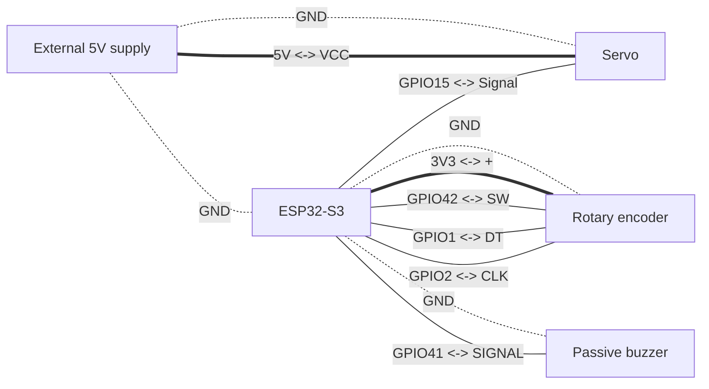

## ESP-IDF Project

```bash
$ idf.py --version
ESP-IDF v6.1
```

## Schematics



## Commands

```shell
# Build project
$ idf.py app

# Flash firmware
$ idf.py flash

# Monitor
$ idf.py monitor

# Clean build files
$ idf.py fullclean
```
